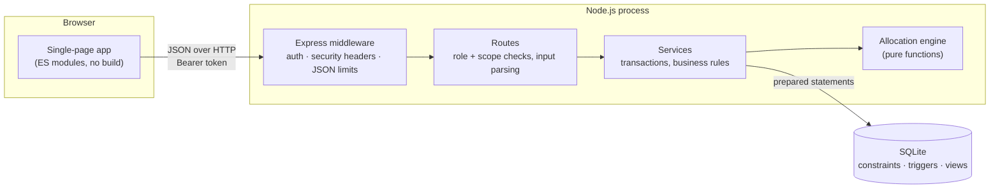

# Architecture

## Goals that shaped the design

1. **Correctness of stock above all.** Over-allocating or losing track of supplies during a disaster is the failure that matters, so integrity is enforced in the database rather than trusted to application code.
2. **Explainability.** Every allocation decision must be reproducible and describable in plain language.
3. **Runs anywhere with one command.** A control room (or a student laptop) should not need to install and configure a database server.
4. **Maintainable.** Few moving parts, the allocation algorithm isolated as pure code, SQL visible rather than hidden behind an ORM.

## Overview

| Layer | Responsibility | Files |
|---|---|---|
| **UI** | Rendering, forms, charts, map; auto-escaped templates; no state beyond the session token and a few filters | `public/` |
| **Routes** | HTTP mapping, authentication, *role and scope* checks (`warehouse_manager` only for their warehouse, `camp_coordinator` only for their camp…), parameter parsing | `server/routes/*` |
| **Services** | One function per business operation; each runs in a single transaction; validation of business rules; audit rows | `server/services/*` |
| **Engine** | Priority scoring and rationing: pure, deterministic, unit-tested in isolation | `server/allocation/engine.js` |
| **Database** | Schema, constraints, triggers, reconciliation views, migrations | `db/migrations/*.sql` |

## A request through the system: committing an allocation

1. `POST /api/allocation/run`: `authenticate` resolves the bearer token (hashed lookup in `sessions`), `requireRole('admin')` rejects anyone else.
2. `commitAllocation` opens `BEGIN IMMEDIATE` via `tx()`.
3. It **re-reads** open demand (`v_open_demand`), available stock, camp/warehouse coordinates, parameters and urgency weights *inside* the transaction.
4. It calls the pure `allocate()`: scores, fair shares, integer rounding, nearest-warehouse sourcing, explanations.
5. It writes the run, one decision per line, shipments (one per warehouse–camp pair), shipment lines, allocation lines; **reserves** stock with conditional `UPDATE`s; appends ledger rows; bumps `quantity_allocated`; recomputes request statuses; adds an audit row.
6. `COMMIT`. Any exception (including an `HttpError(409)` if a reservation fails) triggers `ROLLBACK`: the database is exactly as it was.

The preview endpoint runs steps 3–4 with no writes, so what administrators see is what the engine would do on current data.

## Decisions and trade-offs

| Decision | Why | Trade-off |
|---|---|---|
| **SQLite via `node:sqlite`** | Zero install, a real relational engine with constraints, triggers, views, partial indexes, window functions and CTEs; `BEGIN IMMEDIATE` gives clear serialisable semantics for the write path | Single writer; `node:sqlite` is experimental in Node 22 (API may change); see the PostgreSQL note in DATABASE.md |
| **Raw SQL, no ORM** | The SQL *is* the design: constraints, views and queries stay visible and reviewable | More hand-written SQL |
| **Express 5 as the only dependency** | Familiar, small; async errors reach the central handler | |
| **Vanilla ES-module front end** | No build chain to maintain; an auto-escaping `html` tagged template prevents XSS by default; fast to load | Hand-written DOM updates instead of a framework; no automated browser tests |
| **Services own transactions, engine is pure** | The algorithm can be tested with 600 random scenarios in milliseconds and benchmarked without a database | One extra mapping layer between rows and engine inputs |
| **Reservations (`quantity_reserved`) rather than deducting stock at allocation** | Allocation is a *plan*; stock physically leaves only at dispatch. Cancelling a plan releases the reservation | Two counters to keep consistent (reconciliation views check this) |
| **Append-only ledger + audit log enforced by triggers** | History cannot be rewritten even by someone with SQL access through the app's connection | Corrections are new rows (adjustments), never edits |
| **Settings in tables, snapshotted per run** | Administrators tune the method live; past runs remain explainable | A little extra data per run |
| **Injectable clock** | Seeding replays three days of operations through the real services; tests use fixed times | `at` parameter threaded through services |

## Security

- **Passwords:** `scrypt` with a per-password random salt; constant-time comparison; a dummy hash is verified for unknown users so response time does not reveal which usernames exist.
- **Sessions:** random 256-bit bearer tokens, stored only as SHA-256 hashes, 12-hour expiry, deleted on logout, on deactivation and on password reset. Tokens are sent in an `Authorization` header (not cookies), so classic CSRF does not apply.
- **Authorisation:** every route declares its roles; scope checks (own camp / own warehouse / assigned shipment) are applied on top; database `CHECK`s keep a user's role and scope consistent.
- **Input:** all SQL uses prepared statements with bound parameters (no string-built values); every field is validated for type, range and length; JSON bodies are capped at 100 KB; unknown enum values are rejected (400).
- **Output:** the UI escapes every interpolated value; CSP `default-src 'self'`, `X-Content-Type-Options`, `X-Frame-Options: DENY`, `Referrer-Policy: no-referrer`.
- **Abuse:** per-IP+username login throttling (8 failures per 10 minutes → 429) and an audit entry for every failed sign-in.
- **Audit:** every state-changing operation writes `audit_log` in the same transaction; the table is append-only.
- **Demo conveniences are off in production:** the sign-in demo shortcuts exist only when `NODE_ENV !== 'production'` *and* the demo users are present.

Not covered: TLS (terminate at a reverse proxy), password-complexity policy beyond length, multi-factor authentication, account lockout across restarts (the limiter is in memory).

## Operations

- **Migrations:** `npm run migrate` (also run automatically at server start). Files are applied in name order, each in a transaction, with checksums.
- **Backups:** the database is one file (plus WAL); use `sqlite3 .backup` or copy it while the server is stopped.
- **Health:** Administration → *Data integrity* runs the four reconciliation views; they should always report zero problems.
- **Observability:** structured errors with stable codes (`INSUFFICIENT_STOCK`, `RULE_VIOLATION`, …); unexpected errors are logged to stderr and returned as a generic 500.
