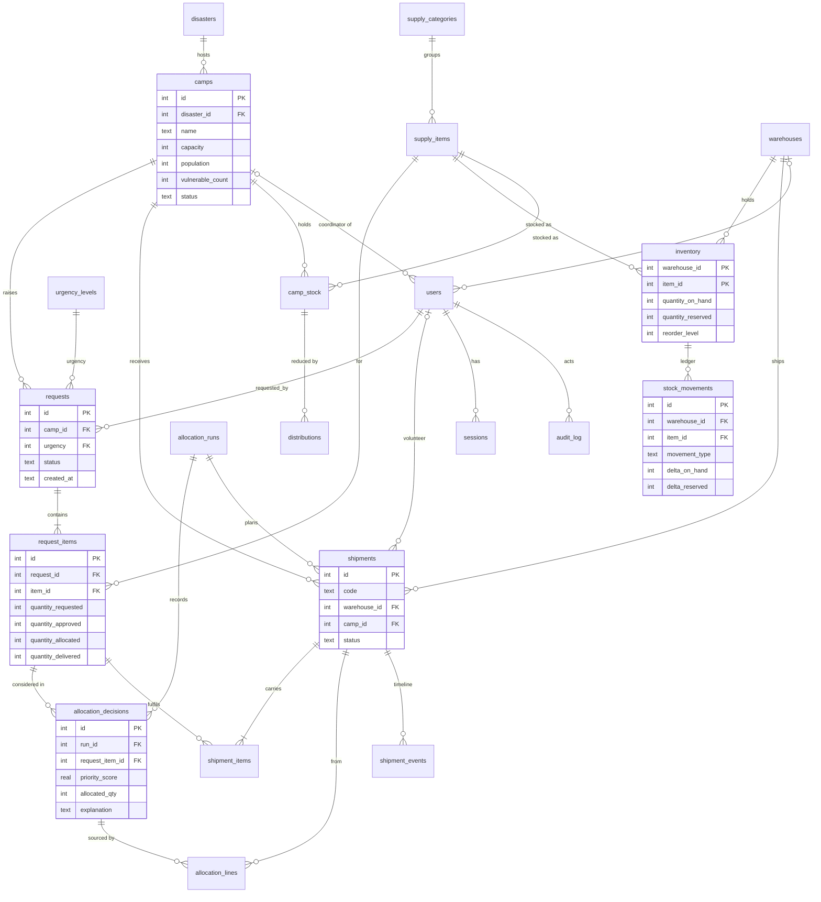

# Database design

SQLite 3.50 (bundled with Node 22) with `PRAGMA foreign_keys = ON` on every connection and WAL journaling. The schema lives in four versioned migrations under [`db/migrations`](../db/migrations); the runner records a SHA-256 checksum of each applied file and refuses to start if an applied migration was edited.

| Object | Count | Where |
|---|---|---|
| Tables | 22 (+ `schema_migrations`) | `001_core_schema.sql` |
| Views | 9 | `002_views.sql` |
| Triggers | 21 | `003_triggers.sql` |
| Indexes | 24 (1 partial) | `001_core_schema.sql` |
| Reference data | urgency levels, allocation settings, categories | `004_reference_data.sql` |

## Entity-relationship diagram



## What each table is for

| Group | Tables | Notes |
|---|---|---|
| Reference | `urgency_levels`, `supply_categories`, `supply_items`, `allocation_settings` | Weights and parameters are *data*, so administrators can tune the method without a deployment |
| Places | `disasters`, `warehouses`, `camps` | A camp belongs to one incident; closed incidents/camps drop out of allocation |
| People | `users`, `sessions` | Role/scope rules are a table `CHECK`; session tokens are stored only as SHA-256 hashes |
| Stock | `inventory`, `stock_movements` | `inventory` is the current balance; `stock_movements` is an append-only ledger that replays to it |
| Demand | `requests`, `request_items` | A line carries four counters: requested → approved → allocated → delivered |
| Decisions | `allocation_runs`, `allocation_decisions`, `allocation_lines` | Immutable record of every committed run, its inputs, scores and sources |
| Logistics | `shipments`, `shipment_items`, `shipment_events`, `camp_stock`, `distributions` | From reservation to residents |
| Audit | `audit_log` | Append-only |

## Normalisation

The design is in **third normal form** apart from a few deliberate, documented exceptions.

- **1NF:** every column is atomic. There are no comma-separated lists or repeating groups: request lines, shipment lines and allocation lines are separate rows. (The only structured text is `allocation_runs.params_json` and `audit_log.details`; both are *immutable snapshots* that are never queried by field.)
- **2NF:** tables with composite keys have no partial dependencies. `inventory(warehouse_id, item_id)` and `camp_stock(camp_id, item_id)` hold only facts about the pair; item names, units and categories live in `supply_items`/`supply_categories`; warehouse names and coordinates in `warehouses`.
- **3NF:** no non-key attribute depends on another non-key attribute. A request stores only the `urgency` *level*; its weight and target hours live in `urgency_levels`. Camp coordinates are stored once in `camps`, not on each shipment. A shipment stores `warehouse_id` and `camp_id`, not their names or districts.

**Deliberate denormalisation (and why each is safe):**

| Denormalised data | Why | How consistency is protected |
|---|---|---|
| `request_items.quantity_allocated / quantity_delivered` | Hot path for the allocator and every dashboard; would otherwise need a join and aggregate on every read | Updated only inside the transaction that changes the shipments; `v_allocation_mismatch` recomputes them from `shipment_items` and must return no rows |
| `inventory.quantity_on_hand / quantity_reserved` | O(1) availability check and a place to hang `CHECK` constraints | Ledger replay `v_ledger_mismatch`; reservation check `v_reservation_mismatch` |
| `requests.status` | Cheap filtering and indexing | Recomputed from the lines by `refreshRequestStatus` in the same transaction |
| `allocation_decisions.approved_qty / prior_qty / need_qty / item_supply / item_demand / urgency_weight …` | A *historical record*: these values change over time and the decision must stay explainable later | Immutable by trigger |
| `shipments.status_changed_at / last_actor_id / last_note` | Lets the status-change trigger write the timeline event with the right actor, time and note | Written by the same `UPDATE` that changes the status |

## Constraints

Declarative integrity does most of the work, so a bug in application code cannot corrupt the data.

- **Keys and uniqueness:** integer primary keys, composite keys on association tables, `UNIQUE` on codes, names, `(request_id, item_id)`, `(run_id, request_item_id)`, case-insensitive usernames.
- **Foreign keys:** everywhere, including the composite `stock_movements(warehouse_id, item_id) → inventory` and `distributions(camp_id, item_id) → camp_stock`. Deletes are restricted by default; only `sessions` and `request_items` cascade.
- **Domain `CHECK`s:** enumerations (`status`, `role`, `movement_type`…), latitude/longitude ranges, positive capacities and weights, `vulnerable_count <= population`.
- **Stock safety:** `quantity_on_hand >= 0`, `quantity_reserved >= 0` and `quantity_reserved <= quantity_on_hand`. This is the last line of defence against over-allocation: even a buggy writer *cannot* reserve more than exists.
- **Request lifecycle arithmetic:** `quantity_delivered <= quantity_allocated <= quantity_approved <= quantity_requested`.
- **Allocation record:** `allocated_qty <= need_qty` and `approved_qty = prior_qty + need_qty`.
- **Role scope:** a camp coordinator must have a camp and no warehouse, a warehouse manager the reverse, admins and volunteers neither.
- **Delivery:** `0 <= quantity_received <= quantity`.

## Triggers (21)

| Purpose | Triggers |
|---|---|
| **Append-only history:** `stock_movements`, `allocation_runs`, `allocation_decisions`, `allocation_lines`, `shipment_events`, `audit_log` reject `UPDATE` and `DELETE` | 12 |
| **Shipment state machine:** only `PLANNED → IN_TRANSIT/CANCELLED` and `IN_TRANSIT → DELIVERED` are legal | `trg_shipments_valid_transition` |
| **Automatic timeline:** an event row is written on insert and on every status change, using the actor/time/note carried on the shipment row | `trg_shipments_event_on_insert`, `trg_shipments_event_on_status` |
| **Shipment lines are immutable;** receipts can only be recorded while in transit | `trg_shipment_items_immutable`, `trg_shipment_items_receipt_state` |
| **Business rules:** no requests for closed camps; closed requests keep their urgency; inventory rows holding stock cannot be deleted; a distribution cannot exceed camp stock | 4 triggers |

## Views (9)

| View | Purpose |
|---|---|
| `v_inventory_available` | warehouse × item with `available = on_hand − reserved` and the below-reorder flag |
| `v_open_demand` | the allocator's work queue: request lines still needing stock in open camps/incidents |
| `v_item_supply_demand` | network-wide supply versus open demand per item (drives shortage alerts) |
| `v_camp_overview`, `v_request_progress` | per-camp and per-request roll-ups for the UI |
| `v_ledger_mismatch`, `v_reservation_mismatch`, `v_allocation_mismatch`, `v_camp_stock_mismatch` | **reconciliation views**: each must return zero rows; the Administration page and the test-suite run them |

## Indexes

Indexes follow the access paths of the application (24 in total); the notable ones:

- `idx_request_items_open ON request_items(item_id) WHERE quantity_allocated < quantity_approved`: a **partial index** containing only lines that still need stock, which is what the allocator scans.
- `idx_requests_status_urgency (status, urgency)`: open-request lists and dashboard counts.
- `idx_movements_wh_item (warehouse_id, item_id, created_at)`: the ledger of one stock line, in time order.
- `idx_shipments_camp (camp_id, status)`, `idx_shipments_warehouse (warehouse_id, status)`, `idx_shipments_volunteer`: role-scoped shipment lists.
- `idx_decisions_run`, `idx_decisions_request_item`, `idx_lines_*`: allocation history lookups in both directions.

`tests/database.test.js` asserts with `EXPLAIN QUERY PLAN` that the hot queries use these indexes.

## Transactions and concurrency

Every multi-statement operation runs inside `tx(db, fn)` (`server/db.js`), which issues **`BEGIN IMMEDIATE`**: the write lock is taken *before* any read, so everything the transaction reads cannot change until it commits. There are three layers of protection against double-booking stock:

1. **Serialised writers + re-read inside the transaction.** `commitAllocation` loads open demand and stock *after* `BEGIN IMMEDIATE`; a plan computed earlier (the preview) is never trusted.
2. **Conditional atomic update.** Reservation is `UPDATE inventory SET quantity_reserved = quantity_reserved + :q WHERE … AND quantity_on_hand − quantity_reserved >= :q`; if `changes ≠ 1` the whole run aborts and rolls back.
3. **`CHECK (quantity_reserved <= quantity_on_hand)`** in the table itself.

| Operation | Atomic unit |
|---|---|
| Create request | request + lines + audit row |
| **Commit allocation** | run + decisions + lines + shipments + shipment lines + reservations + ledger + request counters/statuses + audit |
| Dispatch | stock decrement (on-hand and reserved together) + ledger + shipment status/timeline |
| Deliver | receipts + camp stock + request counters (shortfall released for re-allocation) + status + audit |
| Cancel shipment | reservation release + ledger + request counters + status |
| Receive/adjust stock | inventory + ledger + audit |
| Record distribution | trigger guard + insert + camp stock decrement |

Tested: a fault injected at the *last* step of an allocation run (a trigger that aborts the audit insert) leaves **zero** runs, shipments, reservations, ledger rows or counter changes; two connections to the same file cannot both hold a write transaction; eight concurrent run requests reserve each unit exactly once.

## Sample queries

[`db/queries.sql`](../db/queries.sql) holds 17 named queries, executed by `tests/queries.test.js`. They cover inner/left joins across up to five tables, `GROUP BY … HAVING`, correlated and `NOT EXISTS` subqueries, scalar subqueries, conditional aggregation, `ROW_NUMBER`/`LAG`/running `SUM() OVER`, a recursive CTE (calendar with empty days) and a `UNION ALL` integrity report. For example, *which camps have an open Critical request but nothing on the way?*

```sql
SELECT c.name AS camp, COUNT(*) AS open_critical_requests
FROM camps c
JOIN requests r ON r.camp_id = c.id AND r.urgency = 4 AND r.status IN ('PENDING','PARTIALLY_ALLOCATED')
WHERE NOT EXISTS (SELECT 1 FROM shipments s WHERE s.camp_id = c.id AND s.status IN ('PLANNED','IN_TRANSIT'))
GROUP BY c.id
ORDER BY open_critical_requests DESC;
```

and the ledger replay that proves stock integrity:

```sql
SELECT m.id, m.movement_type, m.delta_on_hand,
       SUM(m.delta_on_hand)  OVER (ORDER BY m.id) AS running_on_hand,
       SUM(m.delta_reserved) OVER (ORDER BY m.id) AS running_reserved
FROM stock_movements m
WHERE m.warehouse_id = 1 AND m.item_id = 5
ORDER BY m.id;   -- the last row equals the inventory row
```

## Moving to PostgreSQL

Nothing in the data model is SQLite-specific. A port would change: `INTEGER PRIMARY KEY` → `GENERATED … AS IDENTITY`, `strftime`/`julianday` → `timestamptz` arithmetic, `INSERT … ON CONFLICT` stays as is, `RAISE(ABORT, …)` triggers → PL/pgSQL trigger functions, and `BEGIN IMMEDIATE` → `SELECT … FOR UPDATE` on the inventory rows (or `SERIALIZABLE` with retry).
